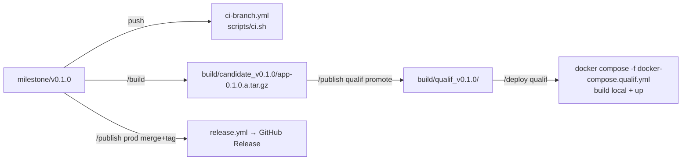

---
mockup:
  composant: systeme
  feature: socle_v0.1.0
  version: 0.1.0
  type: architecture
  issue: "#1, #3"
  validee_le:
  complete: []
  remplace: []
---

# Architecture v0.1.0 — monolithe Node + React + PostgreSQL

```mermaid
flowchart LR
  subgraph Navigateur
    R[Responsable<br/>/login /activities /mailings]
    P[Participant<br/>/a/:slug /r/:token]
  end

  subgraph Conteneur app (image locale)
    S[Express<br/>src/server]
    W[Build React statique<br/>dist/web]
    S -- "sert /" --> W
    S -- "/api/*, /health" --> API[Routes API]
    API --> SVC[Services<br/>auth · activities · registrations · mailings]
    SVC --> M[Mailer<br/>smtp | stub]
    SVC --> DB[(PostgreSQL<br/>conteneur db)]
  end

  R -->|cookie sid| S
  P -->|sans compte| S
  M -.->|SMTP_HOST défini| SMTP[(Serveur SMTP du club<br/>SPF/DKIM)]
  M -.->|SMTP vide| LOG[Journal stub]
```

## Arborescence cible

```
package.json            # racine unique, version 0.1.0.0, scripts build/test/lint/typecheck/start
src/server/             # JavaScript ESM — index.js, app.js, routes/, services/, db/{pool.js,migrate.js,migrations/}, mailer/
src/web/                # React + TypeScript (Vite) — main.tsx, routes/, components/, api/
tests/integration/      # test-writer (supertest + Postgres)
e2e/                    # Playwright
dist/server + dist/web  # sortie de `npm run build` (empaquetée par release.yml)
Dockerfile              # multi-stage : npm ci → npm run build → node dist/server/index.js
docker-compose.qualif.yml / docker-compose.prod.yml   # app + db (postgres:16-alpine), volume pgdata
docker-compose.test.yml # db seule, pour tests d'intégration locaux et CI
```

## Flux de livraison


