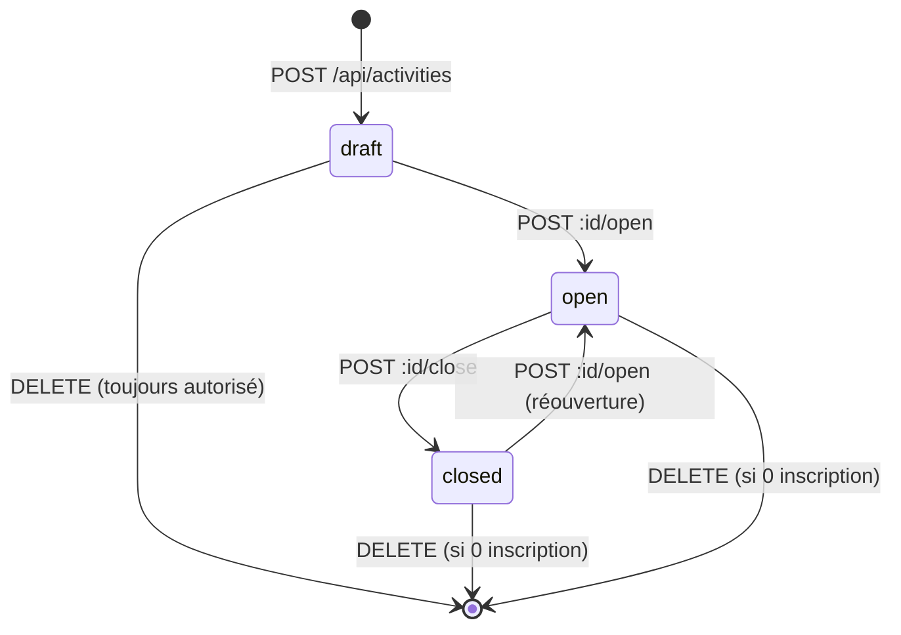
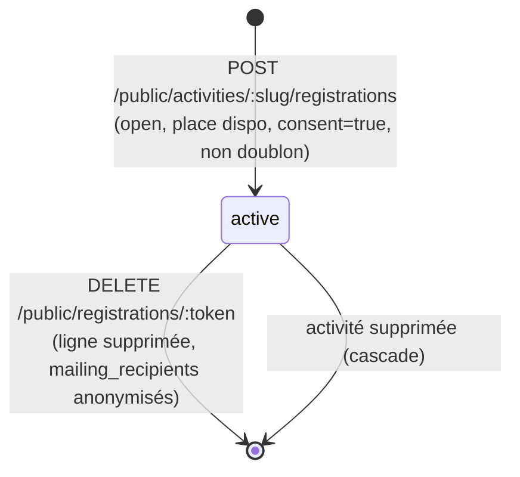
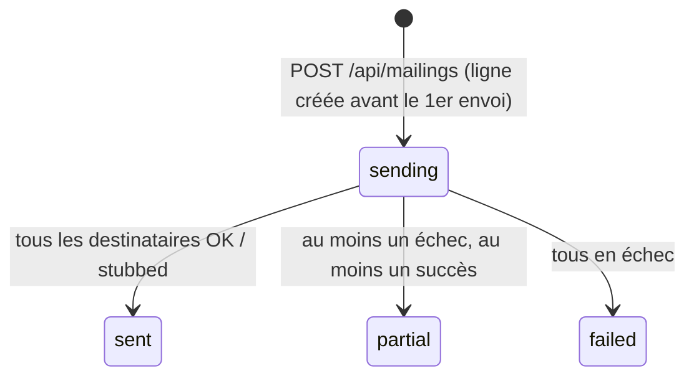

---
mockup:
  composant: activite
  feature: etats_et_inscription
  version: 0.1.0
  type: conception
  issue: "#5, #6"
  validee_le:
  complete: []
  remplace: []
---

# Machine à états — activité et inscription

## Activité (`activities.status`)

| État | Lien public `/a/:slug` | Inscription | Visible responsable |
|------|------------------------|-------------|---------------------|
| draft | 404 | non | oui (badge « Brouillon ») |
| open | fiche + formulaire | oui, si places restantes | oui (badge « Ouverte », lien partageable) |
| closed | fiche « inscriptions fermées » | non (`409 activity_closed`) | oui (badge « Fermée ») |

## Inscription (`registrations`) — cycle de vie

Règles de refus à la création (ordre d'évaluation) : `404` slug/draft → `400` validation → `409 activity_closed`
→ `409 already_registered` → `409 activity_full` (vérification en transaction `FOR UPDATE`).

## Envoi groupé (`mailings.status`)

